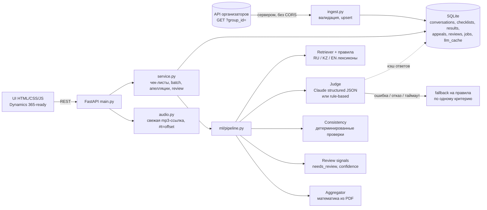

# Архитектура и путь диалога

## Компоненты



## Путь одного диалога

```mermaid
sequenceDiagram
    participant U as UI / оператор QA
    participant A as API
    participant R as Retriever (правила)
    participant J as Judge (Claude)
    participant C as Consistency + Review
    participant G as Aggregator
    U->>A: POST /evaluate {conversation_id, checklist_id}
    A->>R: транскрипт (исходные реплики и timestamp не меняются)
    R-->>A: на каждый критерий: 1–3 реплики-кандидата, «где ожидалось», ответ правил
    loop критерий (или один вызов на все — LLM_STRATEGY=single_call)
        A->>J: [кэш: system + <transcript>] + критерий из JSON чек-листа + подсказки
        J-->>A: {answer, evidence_indices, expected_index, na_reason, explanation, confidence}
    end
    A->>C: ответ вне шкалы / запрещённый N/A → ответ правил; нет evidence → спаны retriever'а
    C->>C: rules vs LLM: agree / near / disagree → needs_review + причины
    A->>G: только ответы → баллы, перераспределение N/A, округление, грубые ошибки отдельно
    G-->>U: criteria[], sections[], overall, critical_error, review_required, pipeline{cost, tokens}
```

## Почему так (решения)

| Решение | Почему |
|---|---|
| Итог считает код, не модель | Правила PDF (вес шкалы, перераспределение N/A, округление half-up, «итог не рассчитывается») детерминированы. LLM в арифметику не допускается, пересмотр проверяющего идёт через ту же функцию `aggregate`. |
| Отдельный вызов на критерий (по умолчанию) | Суждения не влияют друг на друга. Транскрипт стоит общим префиксом с `cache_control`, поэтому вызовы 2–8 читают его по цене кэша. `single_call` — дешевле, переключается через env. |
| Правила + LLM, а не LLM-обёртка | Правила бесплатны, мгновенны и работают без ключа. Их ответ — подсказка модели и независимое второе мнение. Расхождение — честный сигнал для проверки человеком без выдуманной «вероятности». |
| Промпт собирается из JSON чек-листа | Новый или заменённый критерий оценивается без правки кода и промптов (проверка организаторов на t+23h). |
| Кэш ответов модели (`llm_cache`) | Ключ — хэш модели, effort, системного промпта, транскрипта и текста критерия. При замене одного критерия платим за 1 вызов вместо 8; повтор оценки бесплатен. |
| Транскрипт — недоверенные данные | Обёрнут в `<transcript>`, закрывающий тег внутри реплики нейтрализуется, в системном промпте явный запрет выполнять инструкции из текста. |
| Сбой LLM не теряет результат | Ошибка, таймаут, отказ, битый JSON → по этому критерию ответ правил, `source=rules-fallback`, критерий уходит на проверку. Остальные критерии и итог сохраняются. Batch пишет прогресс после каждого диалога; повторный запуск досчитывает остаток; параллельный дубликат возвращает уже идущую задачу. |
| SQLite без ORM, без очередей | Объём хакатона — сотни диалогов. Redis/Celery/vector DB не дают измеримой пользы и добавляют точки отказа. |

## Что сознательно не делали

- **Перенос в слоистую структуру `api/services/repositories`.** ~3.5 тыс. строк читаются целиком; риск перед стоп-кодом больше пользы.
- **Embeddings / BM25.** Retriever ищет 1–3 реплики в диалогах по 10–120 реплик, модель всё равно видит весь транскрипт. Без замера пользы тяжёлую модель не добавляем.
- **Калибровка confidence (ECE, Brier).** Нужна независимая человеческая разметка, у нас её нет (см. [evaluation.md](evaluation.md)). `confidence` — уровень по явным сигналам, не вероятность.
